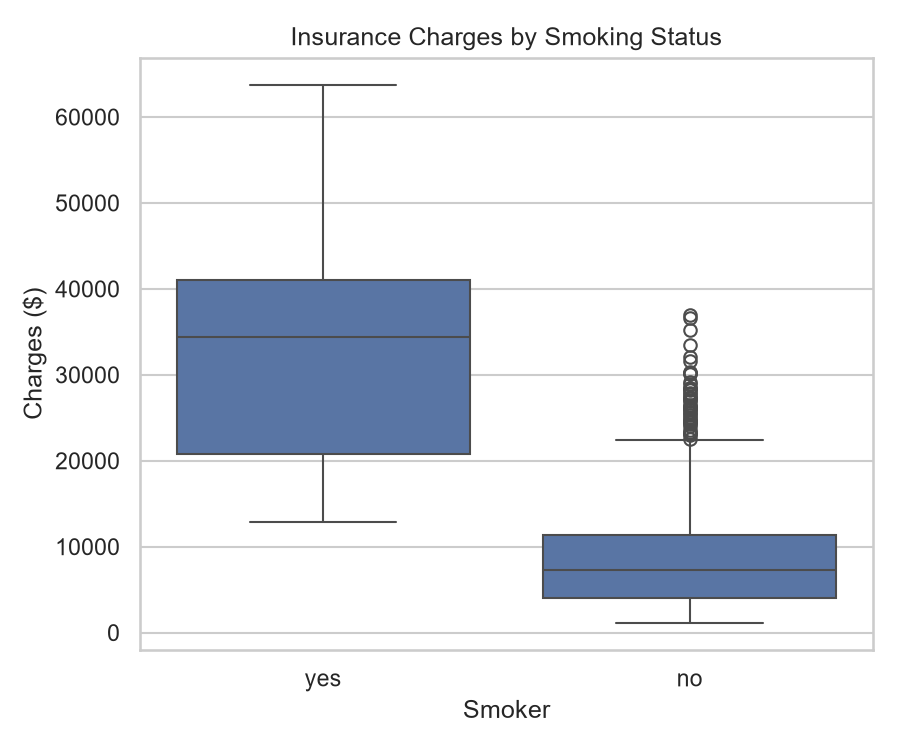
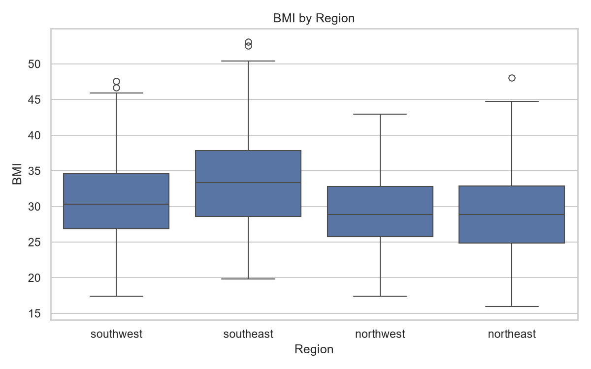

# Health Insurance: Data Exploration and Hypothesis Testing

Exploring a health insurance dataset of 1,338 customer records in Python to identify what drives insurance charges, using visualization, descriptive statistics, and parametric and nonparametric hypothesis testing.

**Tools:** Python 3.12 · pandas · NumPy · Matplotlib · seaborn · SciPy

📄 **[Read the full findings report](reports/findings.md)**

---

## Business Problem

A health insurance company wants to understand which customer characteristics are linked to higher costs, so it can price coverage accurately and invest in programs that reduce claims. This analysis explores the customer data and tests two specific questions: whether health risk (BMI) varies by region, and how much smoking affects insurance charges.

## Results at a Glance

| Question | Test | Result | Decision |
|---|---|---|---|
| Does average BMI differ across regions? | Welch's one-way ANOVA | F = 35.81, p < 0.001, η² = 0.08 | Reject H₀ |
| Do charges differ between smokers and nonsmokers? | Mann-Whitney U | U = 284,133, p < 0.001, r = 0.95 | Reject H₀ |

## Key Findings

| Area | What I found | What it means |
|---|---|---|
| **Smoking** | Smokers' median charge is $34,456 vs. $7,345 for nonsmokers (4.7× higher). A random smoker pays more than a random nonsmoker 97.5% of the time. | Smoking is the single biggest cost driver in the data. |
| **Region and BMI** | The southeast's mean BMI is 33.4, which is 3–4 points above every other region. Five of six region pairs differ significantly. | The southeast is the natural first target for wellness programs. |
| **Region and smoking** | The southeast also has the highest smoking rate (25.0% vs. 17.8–20.7% elsewhere). | Risk factors cluster in the same region. |
| **Charges distribution** | Charges are strongly right-skewed (skewness 1.52). The mean ($13,270) is about $3,900 above the median ($9,382). | A smaller group of high-cost customers drives the average up, so medians better describe the typical customer. |

Each test was chosen to fit the data. BMI is close to symmetric, so it received a parametric test. Charges are heavily skewed, so they received a nonparametric test. When Levene's test showed unequal variances across regions, the analysis switched from classic ANOVA to Welch's ANOVA.


*Insurance charges by smoking status. The middle 50% of smokers' charges sits entirely above the middle 50% of nonsmokers'.*


*BMI by region. The southeast's distribution is shifted higher and more spread out than the others'.*

## Recommendations

- **Invest in smoking-cessation programs.** The median cost gap is about $27,000 per customer per year.
- **Pilot wellness programs in the southeast first,** where both BMI and smoking rates are highest.
- **Review smoker premium pricing** to confirm that it reflects the actual cost difference.

## Project Structure

```
├── data/
│   └── health_insurance.csv              # raw dataset
├── docs/                                 # data dictionary
├── images/                               # univariate, bivariate, and test charts
├── reports/
│   ├── findings.md                       # full findings report
│   └── *.csv                             # descriptive statistics and test results
├── scripts/
│   └── health_insurance_exploration.py   # visualization, statistics, and testing script
├── requirements.txt
└── README.md
```

## How to Run

```bash
git clone https://github.com/ebirdsong88-dev/health-insurance-data-exploration.git
cd health-insurance-data-exploration
python -m venv venv
venv\Scripts\activate          # macOS/Linux: source venv/bin/activate
pip install -r requirements.txt
python scripts/health_insurance_exploration.py
```

The script prints each analysis step and test result to the terminal, then saves the charts to `images/` and the result tables to `reports/`.

## Skills Demonstrated

- Univariate and bivariate visualization matched to variable types
- Descriptive statistics for quantitative and categorical variables
- Choosing between parametric and nonparametric tests based on the data's distribution
- Checking test assumptions (Shapiro-Wilk, Levene's test, Q-Q plots) and adapting the method when an assumption fails
- Post-hoc comparisons with Bonferroni correction
- Reporting effect sizes alongside p-values and translating results into plain language for stakeholders
- Reproducible, documented workflow with Git version control

## Author

**Earl Birdsong**: [GitHub](https://github.com/ebirdsong88-dev)
