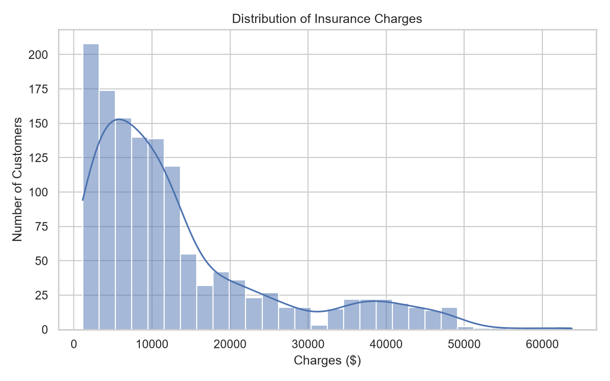
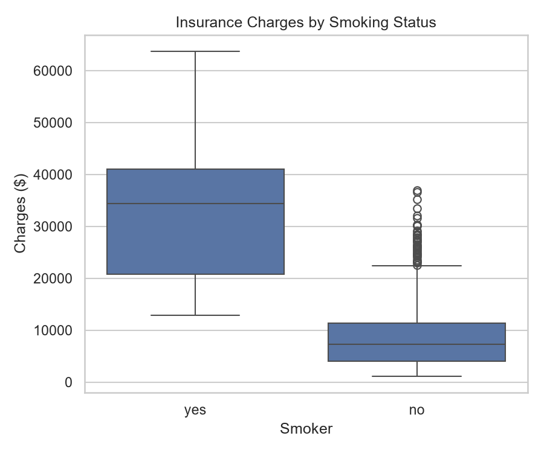
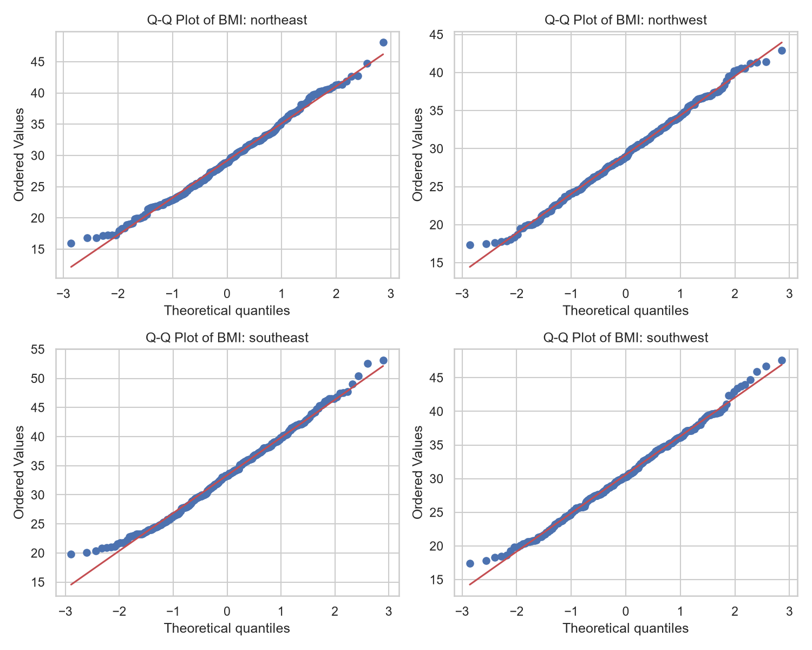
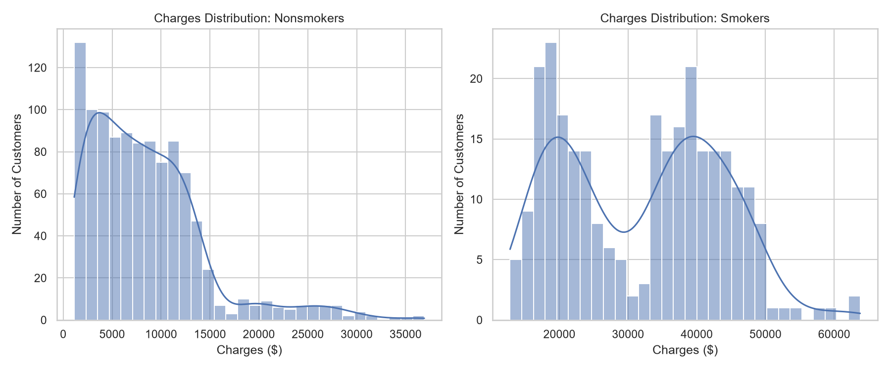

# Health Insurance Data Exploration: Findings Report

## Overview

A health insurance company wants to understand what drives the cost of covering its customers. This report explores 1,338 customer records to identify patterns in insurance charges and health measures. It then uses two hypothesis tests to answer specific business questions.

**Key findings**

- **Smoking is the strongest cost driver in the data.** Smokers' median charge is $34,456, compared with $7,345 for nonsmokers: 4.7 times higher. A randomly chosen smoker has higher charges than a randomly chosen nonsmoker 97.5% of the time.
- **Average BMI differs by region.** The southeast's mean BMI (33.4) is 3 to 4 points higher than every other region's.
- **Charges are heavily right-skewed.** The mean charge ($13,270) is about $3,900 above the median ($9,382), because a smaller group of high-cost customers pulls the average up.

## Contents

1. [Dataset](#1-dataset)
2. [Univariate and Bivariate Analysis](#2-univariate-and-bivariate-analysis)
3. [Descriptive Statistics](#3-descriptive-statistics)
4. [Parametric Test: BMI by Region](#4-parametric-test-bmi-by-region)
5. [Nonparametric Test: Charges by Smoking Status](#5-nonparametric-test-charges-by-smoking-status)

---

## 1. Dataset

- **Records:** 1,338 customers
- **Variables:** 10
- **Missing values:** none
- **Category labels:** clean, with no inconsistent spellings or capitalization

| Variable | Type | Description |
|---|---|---|
| age | Quantitative (discrete) | Customer age in years |
| sex | Categorical (nominal) | Customer sex |
| bmi | Quantitative (continuous) | Body mass index |
| height | Quantitative (continuous) | Height in inches |
| children | Quantitative (discrete) | Number of dependents covered |
| smoker | Categorical (nominal) | Smoking status (yes/no) |
| region | Categorical (nominal) | U.S. region of residence |
| charges | Quantitative (continuous) | Annual insurance charges ($) |
| Level | Categorical (ordinal) | Customer level (A–E) |
| score | Quantitative (discrete) | Customer score (0–100) |

---

## 2. Univariate and Bivariate Analysis

Four variables were selected for visual analysis:

- **charges:** the main business outcome
- **bmi:** a health measure likely related to cost
- **smoker:** a known health risk factor
- **region:** to check for geographic differences

### Univariate findings

- **charges:** strongly right-skewed. About 73% of customers are below $15,000, with a long tail reaching $63,770.
- **bmi:** roughly bell-shaped and centered near 30.
- **smoker:** 20.5% of customers smoke.
- **region:** customers are spread almost evenly across the four regions (24–27% each).

### Bivariate findings

| Pair | Chart | Finding |
|---|---|---|
| charges vs. bmi | Scatter plot | Weak positive relationship (r = 0.20) |
| charges vs. smoker | Box plot | Smokers' charges are far higher, with no overlap between the middle 50% of each group |
| bmi vs. region | Box plot | The southeast has visibly higher BMI |
| smoker vs. region | Grouped bar chart | The southeast has the highest smoking rate (25.0% vs. 17.8–20.7% elsewhere) |

All charts are in [`images/`](../images/).

---

## 3. Descriptive Statistics

### Quantitative variables

| Variable | Mean | Median | Std. Dev. | Min | Max | Skewness |
|---|---|---|---|---|---|---|
| age | 39.21 | 39.00 | 14.05 | 18.00 | 64.00 | 0.06 |
| bmi | 30.66 | 30.40 | 6.10 | 15.96 | 53.13 | 0.28 |
| height | 66.61 | 66.60 | 3.87 | 54.28 | 79.58 | -0.03 |
| children | 1.09 | 1.00 | 1.21 | 0.00 | 5.00 | 0.94 |
| charges | 13,270.42 | 9,382.03 | 12,110.01 | 1,121.87 | 63,770.43 | 1.52 |
| score | 65.97 | 66.00 | 15.24 | 0.00 | 100.00 | -0.30 |

The full table, including variance, range, percentiles, quartiles, and IQR, is in [`descriptive_stats_numeric.csv`](descriptive_stats_numeric.csv).

**Skewness guided test selection.** BMI is close to symmetric, so it suits a parametric test. Charges are strongly skewed (1.52), so they call for a nonparametric test.

### Categorical variables

| Variable | Category counts (percent) |
|---|---|
| sex | male 676 (50.5%), female 662 (49.5%) |
| smoker | no 1,064 (79.5%), yes 274 (20.5%) |
| region | southeast 364 (27.2%), southwest 325 (24.3%), northwest 325 (24.3%), northeast 324 (24.2%) |
| Level | C 427 (31.9%), D 348 (26.0%), B 264 (19.7%), E 187 (14.0%), A 112 (8.4%) |

The full frequency tables are in [`descriptive_stats_categorical.csv`](descriptive_stats_categorical.csv).

---

## 4. Parametric Test: BMI by Region

### Research question

**Does average BMI differ across the four regions?**

BMI is linked to conditions such as diabetes and heart disease that raise long-term claim costs. If some regions have higher average BMI, the company can direct wellness programs where they are likely to have the most impact.

### Test and variables

- **Test:** one-way ANOVA (Welch's version, because of unequal variances)
- **Dependent variable:** `bmi` (quantitative, continuous)
- **Grouping variable:** `region` (categorical, four groups)

### Why this test

One-way ANOVA compares the means of a continuous variable across three or more independent groups, which matches one numeric outcome (BMI) and four regions. Running separate t-tests for every pair would inflate the chance of a false positive. ANOVA tests all groups at once.

The assumptions were checked before running the test:

- **Normality (Shapiro-Wilk):** three regions passed. The southeast was borderline (p = 0.027), but its skewness is only 0.22 and it has 364 observations, so ANOVA is robust to this small departure. The Q-Q plots confirm the data is close to normal.
- **Equal variances (Levene's test): failed** (p = 0.0004), because the southeast's BMI is more spread out. Classic ANOVA assumes equal variances, so **Welch's ANOVA** was used instead. It gives reliable results when variances differ.

### Hypotheses

- **H₀:** Mean BMI is equal across all four regions.
- **H₁:** Mean BMI differs in at least one region.
- **Significance level:** α = 0.05

### Results

| Statistic | Value |
|---|---|
| Welch's F | 35.81 |
| Degrees of freedom | 3, 739.54 |
| p-value | 1.29 × 10⁻²¹ |
| Eta squared | 0.082 |

| Region | n | Mean BMI | Std. Dev. |
|---|---|---|---|
| northeast | 324 | 29.17 | 5.94 |
| northwest | 325 | 29.20 | 5.14 |
| southeast | 364 | 33.36 | 6.48 |
| southwest | 325 | 30.60 | 5.69 |

**Post-hoc comparisons** (Welch t-tests with Bonferroni correction) showed that five of the six region pairs differ significantly. Only the northeast and northwest are statistically the same.

Full results are in [`anova_bmi_region_results.csv`](anova_bmi_region_results.csv) and [`anova_bmi_region_posthoc.csv`](anova_bmi_region_posthoc.csv).

### Decision and answer

The p-value is far below 0.05, so **the null hypothesis is rejected.**

**Answer:** Yes, average BMI differs by region. The southeast's mean BMI of 33.4 falls in the obese range (30 or above) and is 3 to 4 points higher than any other region's. Region explains about 8% of the variation in BMI, so the effect is real but moderate. Most BMI variation comes from individual factors.

### Stakeholder benefits

- **Fewer false alarms:** a single ANOVA keeps the overall error rate at 5%, rather than the inflated rate from running six separate t-tests.
- **Trustworthy results:** checking the assumptions and switching to Welch's ANOVA means the conclusion holds even with unequal variances.
- **Actionable detail:** the post-hoc tests show exactly which regions differ, so leaders know where to focus instead of only learning that "regions differ."

### Recommendations

1. **Pilot wellness programs in the southeast first.** Nutrition coaching, weight-management support, and gym partnerships are likely to reach the most at-risk customers there.
2. **Consider the southwest second.** Its mean BMI is significantly higher than the northern regions'.
3. **Track BMI by region over time** to measure whether the programs are working.

### Limitations

- **Region explains only 8% of BMI variation,** so region-based targeting will miss many high-BMI customers elsewhere. Individual-level programs are still needed.
- **The data is observational.** It shows that the southeast has higher BMI, not why. Diet, income, and climate are possible explanations that the data cannot test.
- **BMI is an imperfect health measure.** It does not distinguish muscle from fat.
- **Results are limited to this sample** and may not reflect the company's full customer base.

---

## 5. Nonparametric Test: Charges by Smoking Status

### Research question

**Do insurance charges differ between smokers and nonsmokers?**

Understanding how much more smokers cost to insure informs pricing, risk assessment, and whether smoking-cessation programs are worth the investment.

### Test and variables

- **Test:** Mann-Whitney U test (two-sided)
- **Dependent variable:** `charges` (quantitative, continuous)
- **Grouping variable:** `smoker` (categorical, two groups)

### Why this test

The Mann-Whitney U test compares two independent groups without assuming the data is normally distributed. It works with ranks instead of raw values, so extreme values do not distort it. A t-test was not appropriate here because:

- **Charges fail the normality check badly** in both groups (Shapiro-Wilk p < 0.0001). Nonsmokers' charges have a skewness of 1.54.
- **The groups are very unequal in size** (274 smokers vs. 1,064 nonsmokers), which makes the t-test more sensitive to violated assumptions.

### Hypotheses

- **H₀:** The distribution of charges is the same for smokers and nonsmokers.
- **H₁:** The distribution of charges differs between smokers and nonsmokers.
- **Significance level:** α = 0.05

### Results

| Statistic | Value |
|---|---|
| U statistic | 284,133 |
| p-value | 5.27 × 10⁻¹³⁰ |
| Rank-biserial r (effect size) | 0.95 |
| Probability a random smoker pays more | 97.5% |

| Group | n | Median | Q1 | Q3 |
|---|---|---|---|---|
| Nonsmokers | 1,064 | $7,345 | $3,986 | $11,363 |
| Smokers | 274 | $34,456 | $20,826 | $41,019 |

Full results are in [`mannwhitney_charges_smoker_results.csv`](mannwhitney_charges_smoker_results.csv).

### Decision and answer

The p-value is far below 0.05, so **the null hypothesis is rejected.**

**Answer:** Yes, charges differ sharply by smoking status. Smokers' median charge is $27,111 higher than nonsmokers', or 4.7 times as much. The effect size (r = 0.95) is extremely large. Smokers' middle 50% of charges begins above the point where nonsmokers' middle 50% ends.

### Stakeholder benefits

- **Results hold up despite skewed data.** Because the test uses ranks, a few very expensive claims cannot distort the conclusion.
- **Medians reflect the typical customer.** The median shows what a typical smoker or nonsmoker costs, which is more useful for pricing than an average pulled up by outliers.
- **Easy to explain:** "a smoker costs more than a nonsmoker 97.5% of the time" is clear to non-technical decision-makers.

### Recommendations

1. **Invest in smoking-cessation programs.** With a median gap of about $27,000 per customer per year, even modest quit rates could produce large savings.
2. **Review premium pricing for smokers** to confirm that it reflects the actual cost difference, within regulatory limits.
3. **Prioritize the southeast for outreach.** It has the highest smoking rate (25%) as well as the highest BMI.

### Limitations

- **The data shows association, not causation.** Smokers may differ from nonsmokers in other ways (age, other health conditions) that also raise charges.
- **The Mann-Whitney test compares whole distributions,** not means specifically. Results are stated in terms of medians and ranks, so they cannot be read as "the average smoker costs $X more."
- **Smoking status is self-reported** and recorded only as yes/no. The data captures neither how much someone smokes nor former smokers.
- **The p-value shows the difference is real but not its cause.** Other variables such as age and BMI were not controlled for. A regression model would be a natural next step.
